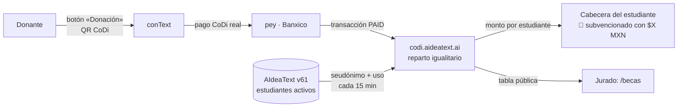

# Sesión 8-nov-2026 · Material para el guion del video demo

Documento de entrega para el agente que escribe el guion. Resume **qué se construyó, por qué y cómo se ve**, con las URLs reales. El estado técnico detallado está en `BITACORA.md`; el recorrido operativo, en `DEMO.md`.

## La idea en una frase
**Cualquier persona dona con CoDi desde conText, y lo donado se reparte en partes iguales entre todos los estudiantes registrados en AIdeaText, que ven en su pantalla cuánto de su uso está subvencionado.**

## Concepto (para el concurso: es una *donación*)
- Ya no es "Invítame un café" ni "sesiones pendientes": es una **donación**.
- Se dona desde **conText** (https://context.aideatext.ai), botón **«Donación»** en la cabecera. Leyenda: *"Estudiantes de distintos estados de México usan conText y las demás herramientas de AIdeaText gracias a tu donación. Dona lo que quieras desde la app de tu banco con CoDi, sin comisiones: se reparte por igual entre todos los estudiantes registrados."*
- El dinero **subvenciona el uso de AIdeaText** (https://v61-dev.aideatext.ai), que ya integra conText, el tutor socrático y el análisis de escritura. No se compran sesiones sueltas ni hay códigos que canjear.
- **Reparto igualitario:** total donado ÷ estudiantes activos. No importa cuánto use cada quien.
- **Rendición de cuentas:** al cierre del ciclo (semestre) se ve quién aprovechó más la subvención y quién menos.
- **Privacidad:** el reparto solo conoce seudónimos de investigación (RES-0001…). Nunca nombres ni correos. El donante ve el impacto, nunca la identidad.
- **Dinero real, sin comisiones:** CoDi (Banxico) vía la API de pey. No hay sandbox: las pruebas usan centavos.

## Flujo que debe mostrar el video

## Escenas sugeridas (con lo que se ve en pantalla)
1. **El problema.** Estudiantes de distintos estados de México necesitan herramientas de escritura académica; no todos pueden pagarlas.
2. **Donar.** https://context.aideatext.ai → botón rojo «Donación» → ventana "💛 Haz una donación" con el QR CoDi. Escanear con la app del banco, elegir monto y pagar. Sin comisiones.
3. **El dinero llega y se reparte.** https://codi.aideatext.ai/becas: "Donaciones a AIdeaText · ciclo 2026-2". Tarjetas con *donado*, *estudiantes*, *para cada uno*, *actividades en el ciclo*, y la tabla por estudiante (seudónimo, institución, subvención, uso).
4. **El estudiante lo ve.** https://v61-dev.aideatext.ai, cuenta demo Ana (`ana.ferrer@alumna.litoral.edu.pe` / `aideatext`). En la cabecera, la etiqueta verde **"🎁 Tu uso de AIdeaText está subvencionado con: $0.0100 MXN"**.
5. **Momento en vivo.** Con la sesión de Ana abierta, otra persona dona **$0.06**. En 20 segundos o menos la etiqueta sube a **$0.0200 MXN** sin recargar la página. Esta es la prueba de que el fondo llegó.
6. **Detalle del estudiante.** Clic en la etiqueta → https://codi.aideatext.ai/beca/RES-0001: "🎁 Tu uso de AIdeaText está subvencionado", el monto, su actividad del ciclo y "Seguir trabajando en AIdeaText →".
7. **Cierre de ciclo.** En `/becas` la tabla ya viene ordenada por uso: quién aprovechó más y quién menos. Transparencia para donantes e instituciones.
8. **Escala.** Hoy hay 6 estudiantes demo de 2 instituciones; el mismo mecanismo funciona con las instituciones reales en edu.aideatext.ai.

## Datos reales al cierre de la sesión (15:31 UTC)
- Pagos reales recibidos: **$0.01** (13:45 UTC, tx `01M6XPH4SA1B8TY9V0SD55891E`, `PAID`) + **$0.05** (14:51 UTC). Total **$0.06 MXN**.
- 6 estudiantes activos → **$0.01 para cada uno**.
- Uso en el ciclo (análisis + turnos con el tutor desde 2026-08-01): RES-0003 = 25, RES-0001 = 23, RES-0004 = 18, RES-0005 = 8, RES-0002 = 7, RES-0006 = 6. Total 87.
- Precio de demo: `PRECIO_SESION=0.01` (para operación real: 10 MXN).

## URLs (24x7)
| Qué | URL |
|---|---|
| Donar | https://context.aideatext.ai (botón «Donación») |
| Aviso de privacidad | https://codi.aideatext.ai/privacidad |
| Reparto público | https://codi.aideatext.ai/becas · JSON: https://codi.aideatext.ai/becas.json |
| Estudiante | https://v61-dev.aideatext.ai · detalle: https://codi.aideatext.ai/beca/RES-0001 |

## Repositorios y commits de hoy
| Repositorio | Qué cambió | Commits |
|---|---|---|
| https://github.com/aideatext/AIdeaText-CODI-MIPEY | Cobro CoDi (pey), reparto igualitario, `/becas`, servicio 24x7, sincronización con v61 | `76bff55` → `c399af0` → `9afe8c6` → `ec07566` → `8ba20fa` → `eef6595` → `6856529` |
| https://github.com/aideatext/conText-HackTheAndes | Botón «Donación» y leyenda nueva (ES/EN) | `ba118f8` |
| https://github.com/aideatext/AIdeaText-v61 | Etiqueta "subvencionado con: $X MXN" en la cabecera del estudiante, se actualiza cada 20 s | `57dac24` → `f85f438` → `8da4eec` |

## Decisiones tomadas en la sesión (orden cronológico)
1. Primer pago real de $0.01 verificado contra la API de pey: la respuesta coincide con el cliente, sin cambios.
2. `USO_TOKEN` de conText: contraseña inventada, la misma en Render y en `.env`.
3. Precio de demo $0.01 para probar con centavos.
4. Se descartó "enlace público con orden de llegada": hacía falta repartir automáticamente.
5. Vínculo con los estudiantes registrados de AIdeaText v61, solo por seudónimo.
6. Reparto: primero por "menos sesiones", luego **igualitario** (pedido de Manuel). Al cierre del ciclo se compara el uso.
7. Todo con URLs públicas y fijas (`codi.aideatext.ai`) y en marcha 24x7 (systemd + túnel Cloudflare + contenedores con reinicio).
8. Precisión: la donación paga **AIdeaText**, no conText aislado. Se quitaron los códigos de canje.
9. Se dona desde **conText**; la página `/cafe` sale del recorrido por redundante. Concepto final: **donación**.
10. La etiqueta muestra el monto acumulado y sube sola con cada donación.

## Pendientes conocidos (no bloquean el video)
- ~~Render: `APOYO_PAGINA_URL`~~ hecho: la ventana de donación muestra «Ver cómo se reparte» → `/becas`.
- La etiqueta de v61 se verificó por API, no en un navegador desde la EC2: confirmarla al grabar.
- Siguientes niveles: persistir el reparto por ciclo con cierre formal y constancias para donantes (ver `PLAN-SESION-PENDIENTE.md`).
